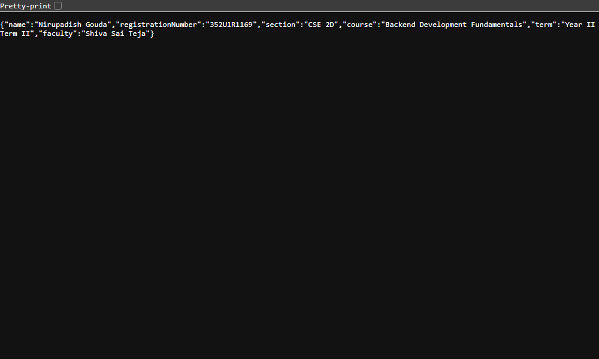
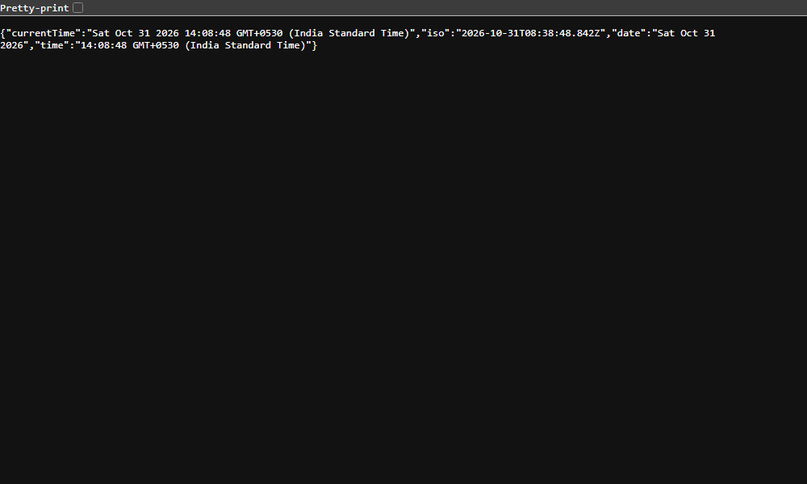
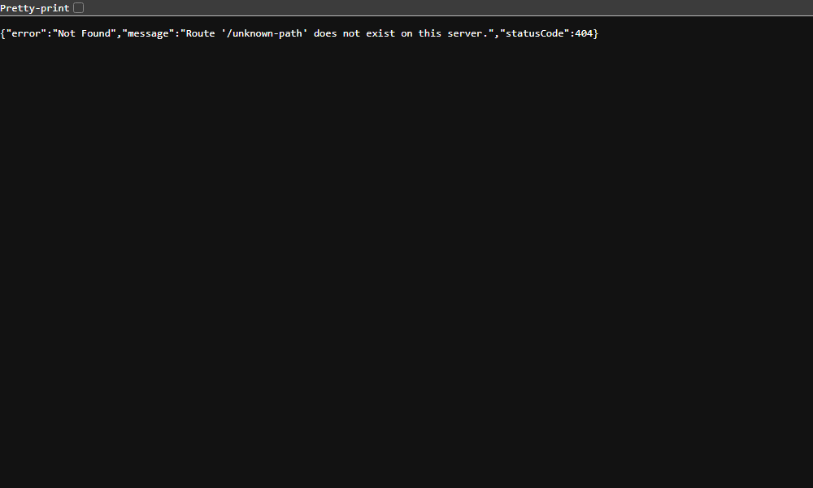

# Lab 1: Node.js and Express server

**Student Name**: Nirupadish Gouda  
**Registration Number**: 252U1R1169  
**Section**: CSE 2D  
**Course**: Backend Development Fundamentals (Year II Term II)  
**Faculty**: Shiva Sai Teja  

---

## Live Link
- **Deploy to Render**: [](https://render.com/deploy?repo=https://github.com/Nirupadish/backend-development-fundamentals)
- **Render Live URL**: [https://backend-development-fundamentals-x67z.onrender.com](https://backend-development-fundamentals-x67z.onrender.com)

> **Note:** The free-plan service may take ~30–60 seconds to wake up after a period of inactivity — this is normal, just refresh the page.

## How to Run

### 1. Prerequisites
- **Node.js** (v18 or higher recommended; verified on Node v24.15.0)
- **npm** (v9 or higher; verified on npm 11.12.1)

### 2. Installation
Navigate into the `lab-01` directory and install project dependencies:
```bash
cd lab-01
npm install
```

### 3. Environment Variables
- `PORT` (Optional): Specifies the network port for the server. Defaults to `3000` if not set.
  ```bash
  # Example (optional):
  PORT=3000
  ```

### 4. Running the Servers

#### Option A: Run the Express Server (Primary Deliverable)
```bash
npm start
```
*Alternatively:* `node server.js`  
The server will start listening at `http://localhost:3000/`.

#### Option B: Run the Plain Node.js HTTP Server
```bash
npm run start:http
```
*Alternatively:* `node http-server.js`  
Runs the native `http.createServer` implementation on port 3000.

#### Option C: Run Automated Route & Status Code Tests
```bash
npm test
```
*Alternatively:* `node test-endpoints.js`  
Executes automated HTTP tests for all endpoints and logs status codes (`200 OK`, `404 Not Found`) and response bodies to the console.

---

## Explanation of `package.json` Fields

| Field | Purpose & Description |
| :--- | :--- |
| **`name`** | The project or package identifier name (lowercase and URL-friendly, e.g., `"lab-01"`). |
| **`version`** | The current semantic version of the project (`"1.0.0"`), following `MAJOR.MINOR.PATCH`. |
| **`description`** | A short, human-readable description explaining the purpose of the package. |
| **`main`** | The entry point script executed when running or importing the module (`"server.js"`). |
| **`scripts`** | A dictionary of custom CLI alias commands executed via `npm run <script-name>` (e.g., `start`, `start:http`, `test`). |
| **`keywords`** | An array of descriptive keywords used for indexing and categorizing the package. |
| **`author`** | The creator or maintainer of the project (`"Nirupadish Gouda"`). |
| **`license`** | The legal license governing open-source or proprietary usage permissions (`"ISC"`). |
| **`type`** | Declares the module system in use (`"commonjs"` for `require`/`module.exports`). |
| **`dependencies`** | Production dependencies required at runtime (`"express"`), specifying compatible version ranges. |

---

## Endpoints Table

| Method | Path | Description | Expected Status Code | Response Type |
| :--- | :--- | :--- | :--- | :--- |
| `GET` | `/` | Welcome text message | `200 OK` | `text/html; charset=utf-8` |
| `GET` | `/about` | JSON containing student name, registration number, section, and course details | `200 OK` | `application/json; charset=utf-8` |
| `GET` | `/time` | Current date, ISO timestamp, and formatted time string using `new Date()` | `200 OK` | `application/json; charset=utf-8` |
| `*` | Any unhandled path (e.g. `/unknown`) | Catch-all 404 handler returning structured error message | `404 Not Found` | `application/json; charset=utf-8` |

---

## Screenshots

### 1. Root Route (`GET /`)
Responds with welcome text and status code `200 OK`.


### 2. About Route (`GET /about`)
Responds with student details in JSON format and status code `200 OK`.


### 3. Time Route (`GET /time`)
Responds with live timestamp information generated via `new Date()` and status code `200 OK`.


### 4. 404 Not Found Handler
Intercepts unknown paths and returns an error response with status code `404 Not Found`.


---

## Notes: Problems Faced and Solutions

1. **Port Conflict (`EADDRINUSE`)**:
   - *Problem*: Attempting to start the server when another process is already listening on port 3000 causes Node.js to throw `Error: listen EADDRINUSE: address already in use :::3000`.
   - *Solution*: Configured `const PORT = process.env.PORT || 3000;` allowing runtime port overrides, and ensured processes close their listeners cleanly upon test completion.

2. **Route Precedence with 404 Middleware**:
   - *Problem*: In Express, middleware executes sequentially in the order registered. Registering the 404 catch-all handler before routes causes all requests to prematurely return 404.
   - *Solution*: Placed the 404 handler (`app.use((req, res) => ...)`) strictly at the very bottom of the middleware chain, after all valid GET routes are declared.

3. **Exclusion of `node_modules` in Version Control**:
   - *Problem*: The `node_modules` directory contains thousands of installed sub-packages, bloating the repository if committed to Git.
   - *Solution*: Configured `.gitignore` at both repository root and inside `lab-01/` to strictly ignore `node_modules/` and `.env`.

---

## Viva Questions & Answers

### Q1: What is the difference between `package.json` and `node_modules`?
- **`package.json`**: A lightweight text/JSON manifest file committed to version control. It records metadata, scripts, and the exact names and semantic version ranges of dependencies required by the project.
- **`node_modules`**: The physical directory generated by npm that contains the actual downloaded source code and binaries of all dependencies and transitive sub-dependencies. It is never committed to Git because anyone with `package.json` can recreate it using `npm install`.

### Q2: What does `app.listen` do?
- **Answer**: `app.listen(port, [callback])` initializes and starts an underlying Node.js HTTP server, binds it to the specified TCP port on the host machine, and begins listening for incoming client network requests. When the server successfully binds and is ready to accept traffic, it triggers the supplied callback function.

### Q3: What do `request` and `response` represent?
- **`request` (`req`)**: An object representing the incoming HTTP request from the client (browser, curl, Postman). It provides properties to inspect client headers, HTTP method (`GET`, `POST`), target URL path (`req.url`), URL parameters (`req.params`), query strings (`req.query`), and request payload (`req.body`).
- **`response` (`res`)**: An object representing the outgoing HTTP response sent back to the client. It exposes methods to set the HTTP status code (e.g., `res.status(200)`), headers (e.g., `res.set()`), and send back text (`res.send()`), files, or formatted JSON data (`res.json()`).
